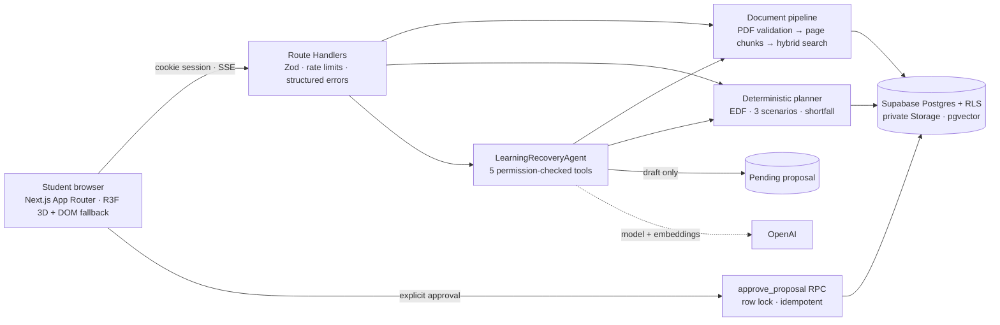

<div align="center">

# CatchUp AI

### Agentic academic recovery: evidence-grounded, feasibility-aware, approval-gated

       

</div>

A student who has fallen behind uploads course PDFs and deadlines. **CatchUp AI** checks whether the work can actually fit before each deadline, compares three honest recovery routes, cites the exact pages behind its advice, and saves a plan **only after the student approves it**.

> Built for the Decoding Data Science "Building Agentic AI Applications" challenge (Nov 2026). All demo data is synthetic.


## Why it is different

| Typical "AI study buddy" | CatchUp AI |
| --- | --- |
| Chatbot guesses a timetable | A deterministic planner computes availability per local day and reports any **shortfall in minutes** |
| Answers from general knowledge | Answers cite **your uploaded pages**, or say "I couldn't verify that" |
| AI writes to your data | The agent only **drafts**; approval is a separate locked, idempotent transaction |
| "The agent did things" | A **real tool timeline**, recorded inside each tool and persisted per run |

## What works today (verified locally)

| Capability | Status |
| --- | --- |
| Passwordless sign-in (6-digit email code or magic link), onboarding with time zone + weekly availability | ✅ |
| Courses and assignments, time-zone-correct deadlines | ✅ |
| Private PDF upload → validation → page-level indexing → hybrid search with page citations; abstains without evidence | ✅ |
| Deterministic planner: **essential / balanced / full** routes, honest shortfall in minutes, what-if availability | ✅ |
| Human approval gate: atomic, idempotent, refuses stale/expired/infeasible plans | ✅ |
| Study schedule with completion, dashboard outlook, 3D learning universe from real data | ✅ |
| **LearningRecoveryAgent** (OpenAI Agents SDK): 5 permission-checked tools, live tool timeline, cited facts kept separate from suggestions, drafts plans for approval | ✅ code + tests · ⚠️ **live OpenAI runs unverified (no API key yet)** |
| Knowledge checks generated from your own notes, server-graded, with source pages | ✅ (deterministic, not LLM-generated) |
| Nature Flow 3.0: alpine-morning / moonlit-forest themes, week schedule, floating-island 3D universe, ⌘K palette | ✅ |
| One-click Missed Class Rescue, Smart Syllabus Import (confirm before save), Focus Sanctuary, data export and account deletion | ✅ |
| Spaced revision (1/3/7/14 days from missed concepts), adaptive retests, baseline vs latest per topic | ✅ |
| One-click judge demo (anonymous account + synthetic data, Turnstile-ready, 24 h cleanup) | ✅ |
| 30-case evaluation (`npm run eval` → `evals/REPORT.md`) | ✅ 25 pass · 0 fail · 5 tool-selection cases pending a real LLM |
| Light / dark / system themes, reduced motion, 3D on/off, no-WebGL fallback, keyboard + screen-reader paths | ✅ |
| Public deployment | ❌ not done (needs your approval and cloud accounts) |

See `BUILD_STATUS.md` for every command run and its result, and `QA_REPORT.md` for the test evidence.

## Screenshots (Nature Flow 3.0)

| Mission control: briefing from real deadlines and capacity | Recovery lab: three honest routes with 7-day timelines |
| --- | --- |
|  |  |
| **Approval gate: exact changes before anything is saved** | **AI copilot: real tool timeline and page citations** |
|  |  |
| **Study schedule: week view in your time zone** | **Learning universe: one floating island per course** |
|  |  |
| **Knowledge vault and smart syllabus import** | **Focus sanctuary: timed sessions saved to your history** |
|  |  |

 

*Screenshots come from the real app on local Supabase with synthetic data. The copilot screenshot uses the deterministic test model (labelled "Scripted test model · not AI" in the UI) because no OpenAI key was configured; tools, retrieval, citations and the approval flow are the real implementation.*

## Architecture



```text
Browser (Next.js App Router · React 19 · R3F v9 scene + DOM fallback)
   │  cookie session (Supabase SSR) · SSE for agent events
   ▼
Next.js Route Handlers (Zod validation · structured errors · per-user DB rate limits)
   ├─ src/proxy.ts ............ session refresh + page guard (Next 16 "proxy")
   ├─ lib/rag ................. PDF validation (unpdf) → page chunks → hybrid search (RRF)
   ├─ lib/planner/engine.ts ... pure EDF scheduler, 3 scenarios, shortfall (no AI)
   ├─ lib/agents .............. LearningRecoveryAgent + 5 typed tools (trusted context)
   └─ lib/quiz ................ grounded cloze generator + server grading
   ▼
Supabase: Auth · Postgres + RLS (composite owner FKs, column grants) · private Storage · pgvector
          SECURITY DEFINER RPCs: approve_proposal / reject_proposal / consume_rate_limit
OpenAI (optional until configured): agent model via OPENAI_MODEL · text-embedding-3-small
```

**Security model in one paragraph:** identity always comes from the verified session (never from the browser or the model). Every child row carries `owner_id` and references its parent through a composite `(id, owner_id)` foreign key, so cross-tenant links are impossible at the schema level; RLS is `owner_id = auth.uid()`; the browser role has column-level grants only. Server-owned tables (chunks, agent runs, proposals, plans, quiz keys) are read-only or invisible to students. The agent can only read and *draft*; approval is a separate locked, idempotent database transaction the student triggers. PDF text is treated as untrusted data everywhere.

## Run it locally

Prerequisites: Node ≥ 20.9, Docker, [Supabase CLI](https://supabase.com/docs/guides/cli).

```bash
npm install
npm run db:start          # local Supabase in Docker (first run pulls images)
npm run db:reset          # apply supabase/migrations
cp .env.example .env.local   # then fill values from `supabase status`
npm run dev               # http://localhost:3000
```

Sign in at `/login`; locally the 6-digit code arrives in Mailpit at http://127.0.0.1:54324.

Optional synthetic demo data (fictional student "Alex Morgan"):

```bash
npm run seed:demo -- --email you@example.com
```

Then upload `data/statistics_module_4_synthetic.pdf` to the Applied Statistics course.

### Enable the AI copilot

Add to `.env.local` and restart:

```bash
OPENAI_API_KEY=...        # never commit
OPENAI_MODEL=...          # a function-calling model available to your OpenAI project
```

Without a key, everything except the copilot works; documents are indexed for keyword search, and embeddings are added for documents processed after a key is configured.

## Tests

```bash
npm run typecheck && npm run lint
npm test                    # unit (Vitest)
npm run test:integration    # real local Supabase: RLS, storage, RAG, approval, agent tools
npm run test:e2e            # Playwright against a production build on :3100
npm run eval                # 30-case evaluation → evals/REPORT.md
npm run preflight           # environment checks (add -- --production before deploying)
```

Deploying: see [docs/DEPLOYMENT.md](docs/DEPLOYMENT.md) (Supabase cloud, Resend SMTP, Turnstile, Vercel, OpenAI).

The agent is tested with a **scripted stand-in model** that speaks the Agents SDK protocol, so the run loop, tools, database and persistence execute for real while the LLM is replaced. That model can be enabled only with `CATCHUP_TEST_MODEL=scripted` **and** a local Supabase URL, and the UI labels it "Scripted test model · not AI".

## Project layout

```text
src/app/(app)/*          nine authenticated screens (dashboard, universe, assistant, recovery, courses, planner, quizzes, insights, settings)
src/app/api/*            route handlers (see docs/05_API_CONTRACT.md)
src/components/          shell, UI kit, 3D scene, feature components
src/lib/                 auth, db access, planner, rag, agents, quiz, validation
supabase/migrations/     schema, RLS, search and approval functions
tests/{unit,integration,e2e}
design-reference/        original nine-screen HTML concept (simulated; not the app)
```

## Known limitations

- Live OpenAI agent runs and embeddings have **not** been exercised (no key provided). Retrieval thresholds were tuned on lexical search and a test embedder; re-tune after enabling real embeddings.
- Text-based PDFs only (no OCR), ≤ 10 MB and ≤ 50 pages, processed synchronously.
- Knowledge checks are fill-in-the-blank from your own sentences, not LLM-written questions.
- No public deployment, no Content-Security-Policy yet (inline theme script), no institutional LMS integration.
- Planner assumes one daily study window per day starting at a fixed local time.

## License and data

Synthetic demo content only. Do not upload real student records or institution-owned material without permission.
