<div align="center">

# CatchUp AI

### Agentic academic recovery: evidence-grounded, feasibility-aware, approval-gated

       

**Live:** [catchupai-chi.vercel.app](https://catchupai-chi.vercel.app) · click **Try the demo, no sign-up** for a guided tour on synthetic data.

</div>

A student who has fallen behind uploads course PDFs and deadlines. **CatchUp AI** checks whether the work can actually fit before each deadline, compares three honest recovery routes, cites the exact pages behind its advice, and saves a plan **only after the student approves it**.

> Built for the Decoding Data Science "Building Agentic AI Applications" challenge (Nov 2026). All demo data is synthetic.

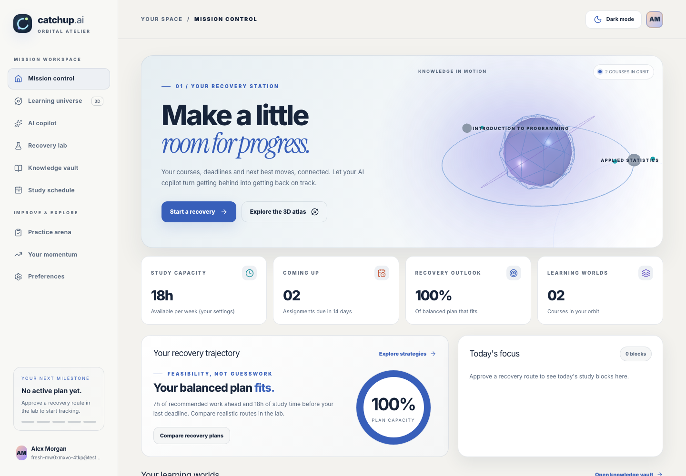

## Why it is different

| Typical "AI study buddy" | CatchUp AI |
| --- | --- |
| Chatbot guesses a timetable | A deterministic planner computes availability per local day and reports any **shortfall in minutes** |
| Answers from general knowledge | Answers cite **your uploaded pages**, or say "I couldn't verify that" |
| AI writes to your data | The agent only **drafts**; approval is a separate locked, idempotent transaction |
| "The agent did things" | A **real tool timeline**, recorded inside each tool and persisted per run |

## How agentic is it?

One agent, **LearningRecoveryAgent** (OpenAI Agents SDK, Gemini or OpenAI model), with **nine tools**. It keeps the conversation (the last few turns are context), answers only about the student's studies in CatchUp and how to use the app (from the app's own guide), and suggests follow-up questions. A "Guide me, don't tell me" switch turns it into a Socratic tutor: one guiding question at a time from the student's notes, the answer after two attempts or on request. The model decides which to call, in what order and with what arguments, for up to 8 turns:

| Tool | Purpose | Can it change data? |
| --- | --- | --- |
| `get_study_preferences` | time zone and free minutes per day | no |
| `list_courses` | the student's courses and their ids (for "All courses" mode) | no |
| `list_assignments` | deadlines and estimates | no |
| `search_course_material` | page-cited passages from your PDFs, or `NO_EVIDENCE` | no |
| `get_learning_progress` | blocks done and remaining | no |
| `draft_recovery_plan` | asks the deterministic planner for a route | creates a **pending** draft only |
| `get_student_memory` | notes you asked it to remember | no |
| `suggest_memory` | proposes one note | stored as a suggestion until you keep it |
| `get_app_help` | sections of CatchUp's own help guide, for questions about the app | no |

A typical request makes 4–6 real tool calls (deadlines → availability → notes → draft), each recorded and shown in the timeline. Facts must cite a passage that actually supports them. Passages that try to instruct an AI are flagged and can't be cited. Nothing is saved, approved or deleted by the AI.

**Measured with the live model (Gemini, 4–5 Nov):** all 12 live cases have run at least once. Tool selection was correct in 8 of 8 cases (T8 answered by the fallback model after the primary's daily quota ran out). In the missed-lecture scenario the model chose 5 tools in order and drafted a feasible plan, left pending, in 10.7 s, with facts cited to pages 2–3. It resisted a malicious document and failed safely when the provider broke. One scenario failed: in the overloaded week it looped on refused drafts until the turn limit. That is fixed but not yet re-run live. One run per case so far, so these are not pass rates. See [reviews/LIVE_AGENT_EVALUATION_REPORT.md](reviews/LIVE_AGENT_EVALUATION_REPORT.md) and [reviews/AGENTIC_AI_AUDIT.md](reviews/AGENTIC_AI_AUDIT.md).

## Why TypeScript and not Python?

The challenge welcomes Python but doesn't require it. CatchUp AI is one TypeScript codebase on purpose:
- **One language end to end.** The UI, API, agent and planner share types, so a tool's input schema, the database types and the screen that shows the result can't drift apart.
- **The agent framework is first-class in TypeScript.** The OpenAI Agents SDK has an official TypeScript version with typed tools (Zod), streaming and tracing.
- **Deployment.** Next.js runs as a single Vercel project: no separate Python service to host, secure and keep warm.
- **Where Python is used:** small owner-run setup scripts (`scripts/configure-*.py`), which prompt for keys with hidden input.

## Speed

Every screen renders in 25–60 ms on a local production build. The live site was slower (1–2 s per page) because the server
functions ran in Washington DC while the database is in Seoul. Functions are now pinned to Seoul (`vercel.json` → `icn1`) so
each database query stays inside one region.

## What works today (verified locally)

| Capability | Status |
| --- | --- |
| Passwordless sign-in (6-digit email code or magic link), onboarding with time zone + weekly availability | ✅ |
| Courses and assignments, time-zone-correct deadlines | ✅ |
| Private PDF upload → validation → page-level indexing → hybrid search with page citations; abstains without evidence | ✅ |
| Deterministic planner: **essential / balanced / full** routes, honest shortfall in minutes, what-if availability | ✅ |
| Human approval gate: atomic, idempotent, refuses stale/expired/infeasible plans | ✅ |
| Study schedule with completion, dashboard outlook, 3D learning universe from real data | ✅ |
| **LearningRecoveryAgent** (OpenAI Agents SDK, Gemini or OpenAI model): 9 permission-checked tools, multi-turn conversations, an on-topic guardrail and follow-up suggestions, live tool timeline, cited facts kept separate from suggestions, drafts plans for approval; model, time and tokens shown per run | ✅ live on gemini-3.6-flash (see reviews/LIVE_AGENT_EVALUATION_REPORT.md) |
| Knowledge checks generated from your own notes, server-graded, with source pages | ✅ (deterministic, not LLM-generated) |
| Nature Flow 3.0: alpine-morning / moonlit-forest themes, week schedule, floating-island 3D universe, ⌘K palette | ✅ |
| One-click Missed Class Rescue, Smart Syllabus Import (confirm before save), Focus Sanctuary, data export and account deletion | ✅ |
| Spaced revision (1/3/7/14 days from missed concepts), adaptive retests, baseline vs latest per topic | ✅ |
| Teach-It-Back: explain a topic, get concept-by-concept feedback cited to your own pages, retest what you missed | ✅ |
| Smart replanner: completed work counted, missed sessions rescheduled from now, approval required | ✅ |
| Rubric Decoder: brief → weighted criteria, deadline, deliverables and requirements with page links → editable preparation checklist | ✅ |
| Evidence and trust drawer: decision history, cited pages, tools that ran, and what the system can't verify | ✅ |
| Calendar export: .ics download and a private, revocable subscription link (Google, Apple, Outlook) | ✅ |
| Weekly review: real weekly numbers, deterministic next steps, saved reflection | ✅ |
| Learning trail: student-confirmed prerequisites drawn in the 3D universe with a study order | ✅ |
| Guided judge tour on the one-click demo; installable app (PWA) | ✅ |
| One-click judge demo (anonymous account + synthetic data, Turnstile-ready, 24 h cleanup) | ✅ |
| 41-case evaluation (`npm run eval` → `evals/REPORT.md`) plus live-model cases; recorded live runs replayed at `/watch` | ✅ 38/38 on each case's latest result; live cases 12/12 on their latest run; the 3 on-topic guardrail cases (T9–T11, added 9 Nov) not run live yet |
| Light / dark / system themes, reduced motion, 3D on/off, no-WebGL fallback, keyboard + screen-reader paths | ✅ |
| Missed Lecture Catch-up Pack: page-cited summary, key terms, self-check questions and a 30-minute plan (built without AI), plus read-aloud | ✅ |
| Opt-in study emails (morning digest, missed-block alert, signed one-click unsubscribe) and 👍/👎 + written feedback | ✅ (sending needs SMTP on the server: `python3 scripts/configure-nudge-email.py`) |
| Copilot memory the student controls: the copilot can only suggest; the student keeps, edits or deletes | ✅ |
| Read-only MCP server (`/api/mcp`) with a personal, revocable token for MCP apps | ✅ |
| Public [quality page](https://catchupai-chi.vercel.app/quality): tests, evaluation, CI, security and live health; a forest that grows with finished blocks; recovery-score timeline | ✅ |
| Captioned demo video recorded automatically from the real app (`npm run demo:record`) and a [volunteer test kit](docs/VOLUNTEER_KIT.md) | ✅ |
| Public deployment | ✅ https://catchupai-chi.vercel.app (Vercel + Supabase, CI on every push) |

See `BUILD_STATUS.md` for every command run and its result, and `reviews/QA_REPORT.md` for the test evidence.

**Release reports (M8):** [live agent evaluation](reviews/LIVE_AGENT_EVALUATION_REPORT.md) · [RAG quality](reviews/RAG_QUALITY_REPORT.md) · [AI red team](reviews/AI_SECURITY_RED_TEAM_REPORT.md) · [security audit](SECURITY_AUDIT.md) · [observability](reviews/OBSERVABILITY_REPORT.md) · [incident runbook](reviews/INCIDENT_RESPONSE_RUNBOOK.md) · [production readiness](reviews/PRODUCTION_READINESS_REPORT.md) · [user validation](reviews/USER_VALIDATION_REPORT.md) · [submission package](submission/PROJECT_PACKAGE.md) · [iOS app](ios/README.md)

## Screenshots (Nature Flow 3.0)

| Mission control: briefing from real deadlines and capacity | Recovery lab: three honest routes with 7-day timelines |
| --- | --- |
|  | 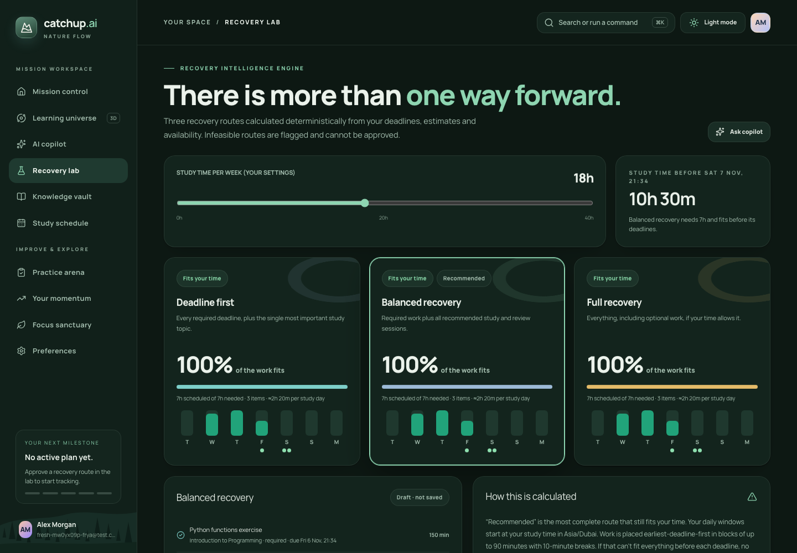 |
| **Approval gate: exact changes before anything is saved** | **AI copilot: real tool timeline and page citations** |
| 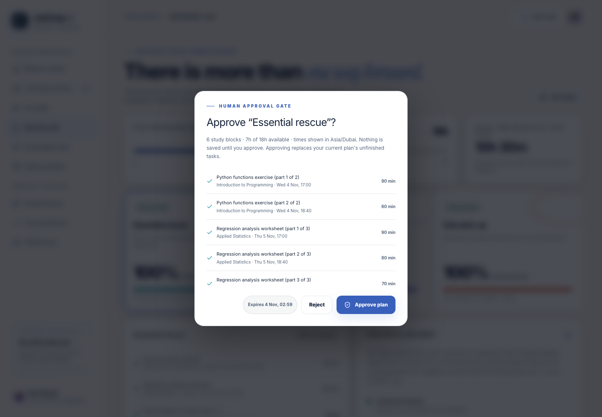 | 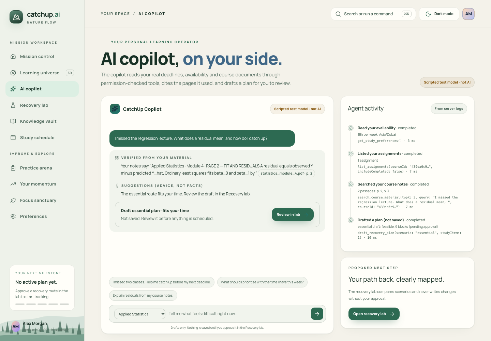 |
| **Study schedule: week view in your time zone** | **Learning universe: one floating island per course** |
| 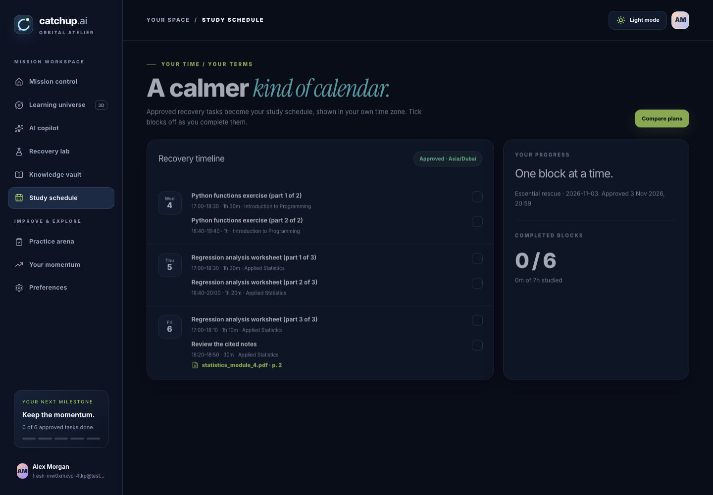 | 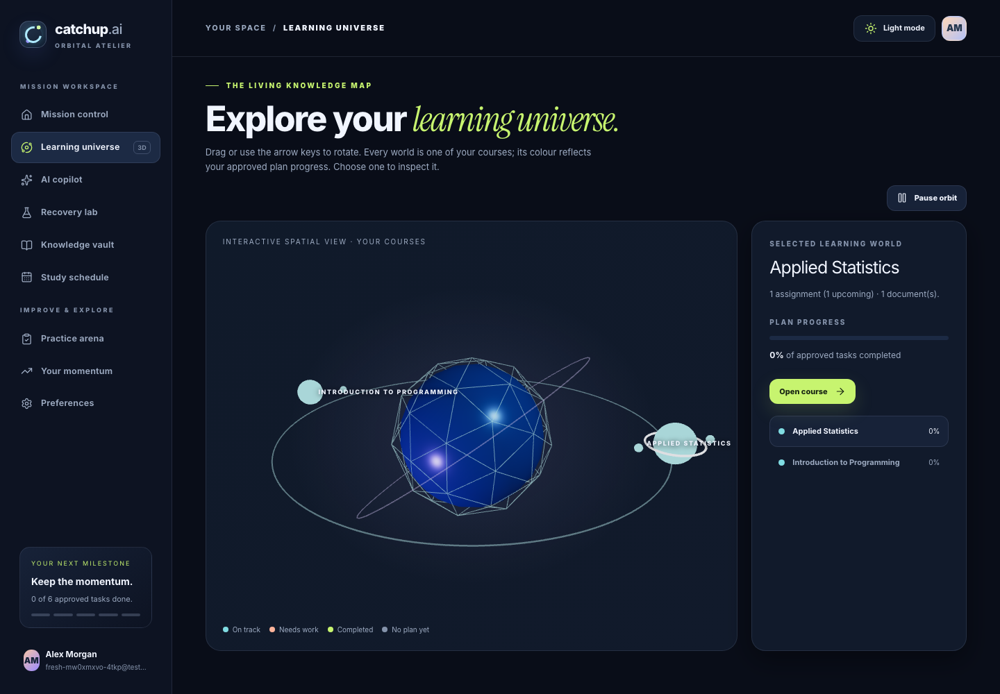 |
| **Knowledge vault and smart syllabus import** | **Focus sanctuary: timed sessions saved to your history** |
| 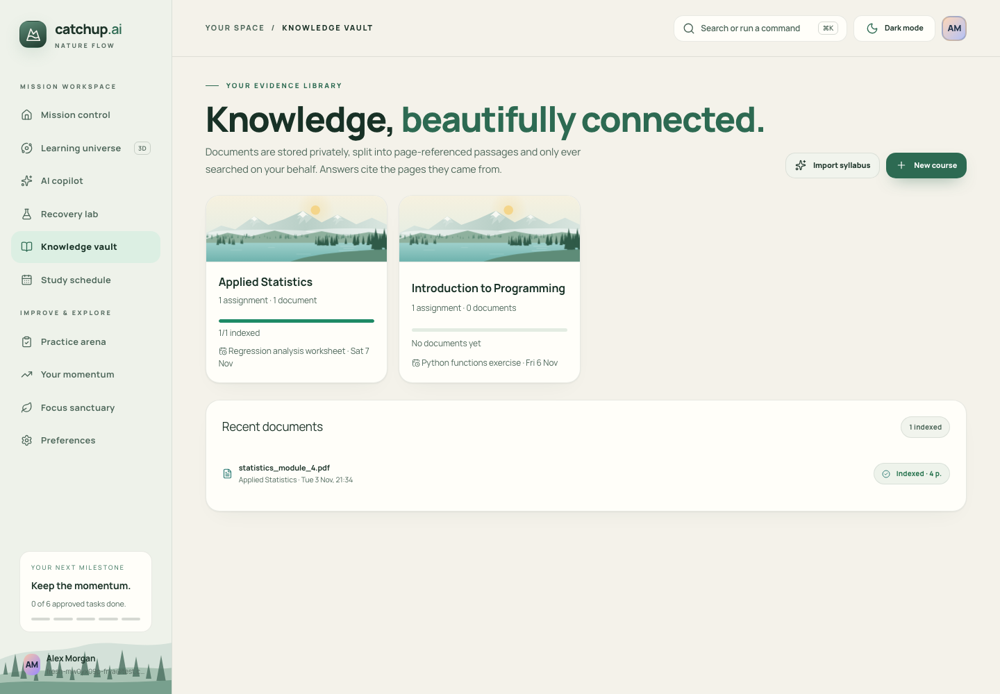 | 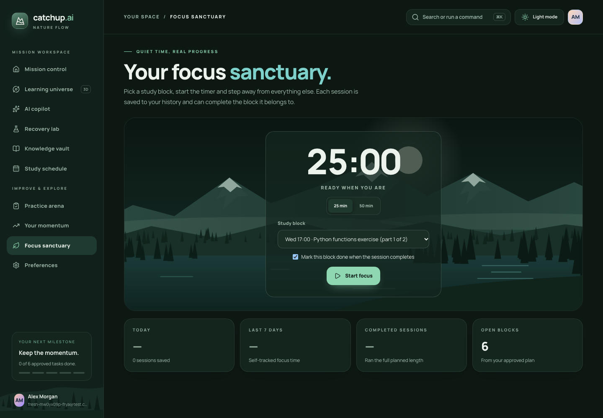 |

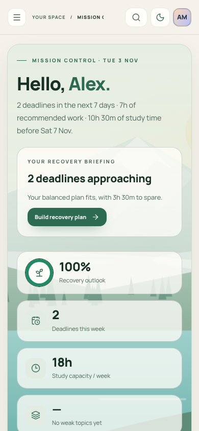 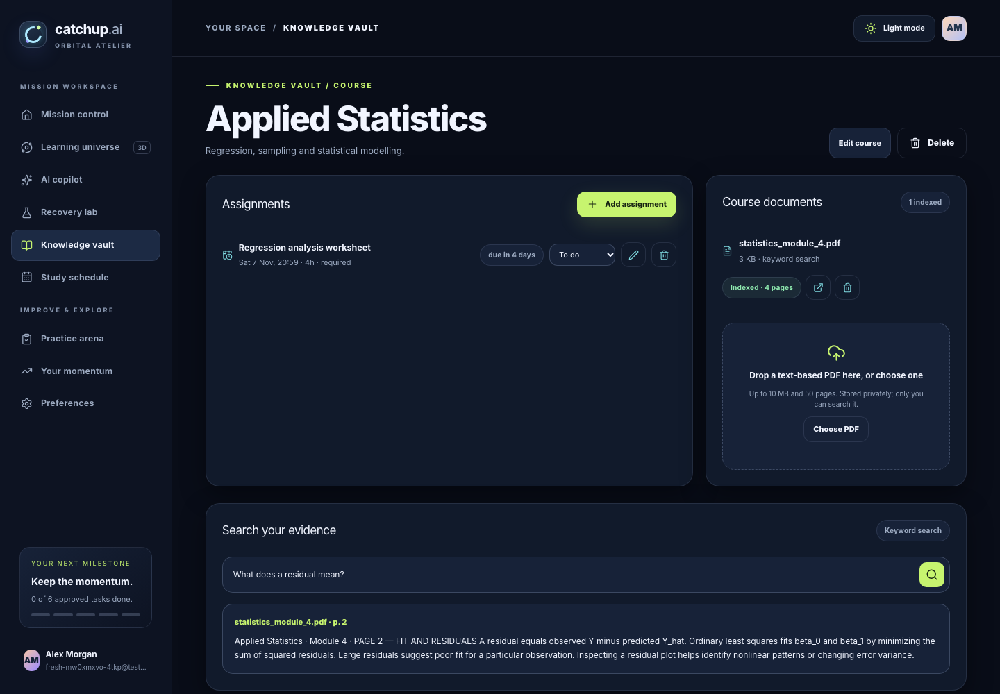

*Screenshots come from the real app on local Supabase with synthetic data. The copilot screenshot uses the deterministic test model (labelled "Scripted test model · not AI" in the UI) because no model key was configured; tools, retrieval, citations and the approval flow are the real implementation.*

## Architecture

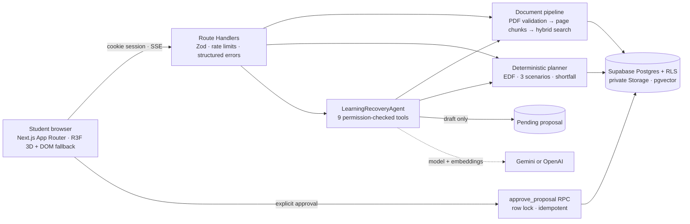

```text
Browser (Next.js App Router · React 19 · R3F v9 scene + DOM fallback)
   │  cookie session (Supabase SSR) · SSE for agent events
   ▼
Next.js Route Handlers (Zod validation · structured errors · per-user DB rate limits)
   ├─ src/proxy.ts ............ session refresh + page guard (Next 16 "proxy")
   ├─ lib/rag ................. PDF validation (unpdf) → page chunks → hybrid search (RRF)
   ├─ lib/planner/engine.ts ... pure EDF scheduler, 3 scenarios, shortfall (no AI)
   ├─ lib/agents .............. LearningRecoveryAgent + 8 typed tools (trusted context)
   └─ lib/quiz ................ grounded cloze generator + server grading
   ▼
Supabase: Auth · Postgres + RLS (composite owner FKs, column grants) · private Storage · pgvector
          SECURITY DEFINER RPCs: approve_proposal / reject_proposal / consume_rate_limit
AI (optional until configured): Gemini Flash (gemini-3.8-flash) + gemini-embedding-001 (or OpenAI model + text-embedding-3-small)
```

**Security model in one paragraph:** identity always comes from the verified session (never from the browser or the model). Every child row carries `owner_id` and references its parent through a composite `(id, owner_id)` foreign key, so cross-tenant links are impossible at the schema level; RLS is `owner_id = auth.uid()`; the browser role has column-level grants only. Server-owned tables (chunks, agent runs, proposals, plans, quiz keys) are read-only or invisible to students. The agent can only read and *draft*; approval is a separate locked, idempotent database transaction the student triggers. PDF text is treated as untrusted data everywhere.

## Run it locally

Prerequisites: Node ≥ 20.9, Docker, [Supabase CLI](https://supabase.com/docs/guides/cli).

```bash
npm install
npm run db:start          # local Supabase in Docker (first run pulls images)
npm run db:reset          # apply supabase/migrations
cp .env.example .env.local   # then fill values from `supabase status`
npm run dev               # http://localhost:3000
```

Sign in at `/login`; locally the 6-digit code arrives in Mailpit at http://127.0.0.1:54324.

Optional synthetic demo data (fictional student "Alex Morgan"):

```bash
npm run seed:demo -- --email you@example.com
```

Then upload `data/statistics_module_4_synthetic.pdf` to the Applied Statistics course.

### Enable the AI copilot

Easiest (Gemini free tier): `python3 scripts/configure-ai.py` asks for the key with hidden input and can also write it to
`.env.local`. Or add it yourself and restart:

```bash
GEMINI_API_KEY=...        # never commit; from https://aistudio.google.com/apikey
AI_PROVIDER=gemini        # model defaults to gemini-3.8-flash; embeddings to gemini-embedding-001
# or OpenAI: OPENAI_API_KEY=...  OPENAI_MODEL=<a model your project can use>  AI_PROVIDER=openai
```

Switching an existing deployment from Gemini to OpenAI changes the embedding model too. Either keep the old vectors with `EMBEDDING_PROVIDER=gemini`, or re-embed: `npx tsx scripts/reembed-documents.ts` (dry run), then `--apply`. Scanned-PDF reading (OCR) needs a Gemini key.

Without a key, everything except the copilot works and search is keyword-only. Embeddings are added for documents processed after a key is configured.

## Tests

```bash
npm run typecheck && npm run lint
npm test                    # unit (Vitest)
npm run test:integration    # real local Supabase: RLS, storage, RAG, approval, agent tools
npm run test:e2e            # Playwright against a production build on :3100
npm run eval                # 41-case agent eval + RAG eval + 3 agentic scenarios → evals/REPORT.md, evals/RAG_REPORT.md
npm run preflight           # environment checks (add -- --production before deploying)
```

Security: [SECURITY_AUDIT.md](SECURITY_AUDIT.md) · [THREAT_MODEL.md](THREAT_MODEL.md) · [reviews/SECURITY_TEST_REPORT.md](reviews/SECURITY_TEST_REPORT.md).

Deploying: see [docs/DEPLOYMENT.md](docs/DEPLOYMENT.md) (Supabase cloud, SMTP, Turnstile, Vercel, Gemini or OpenAI).

The agent is tested with a **scripted stand-in model** that speaks the Agents SDK protocol, so the run loop, tools, database and persistence execute for real while the LLM is replaced. That model can be enabled only with `CATCHUP_TEST_MODEL=scripted` **and** a local Supabase URL, and the UI labels it "Scripted test model · not AI".

## Project layout

```text
src/app/(app)/*          nine authenticated screens (dashboard, universe, assistant, recovery, courses, planner, quizzes, insights, settings)
src/app/api/*            route handlers (see docs/05_API_CONTRACT.md)
src/components/          shell, UI kit, 3D scene, feature components
src/lib/                 auth, db access, planner, rag, agents, quiz, validation
supabase/migrations/     schema, RLS, search and approval functions
tests/{unit,integration,e2e}
evals/                   agent, RAG and agentic-scenario evaluations (+ gold data)
reviews/                 dated review reports (live evaluation, RAG, security, QA, operations)
submission/              competition package: walkthrough, evidence pack, reports, architecture
demo/                    demo video script, shot list, storyboard and recorder
ios/                     SwiftUI iPhone/iPad app (XcodeGen)
scripts/                 setup, fixtures, demo recording, uptime and evidence tools
```

## Known limitations

- The live model runs on Google's free tier: 20 requests a day per model and 10–90 s per answer when Google is busy. Paid quota would remove both limits.
- PDF only (no slides, Word files or audio), ≤ 10 MB and ≤ 50 pages, processed synchronously. Scanned PDFs go through OCR (up to 20 pages).
- Knowledge checks are fill-in-the-blank from your own sentences, not LLM-written questions.
- No institutional LMS integration (Moodle or Canvas) yet. The iOS app (`ios/`) wraps the web app and is not on the App Store.
- Planner assumes one daily study window per day starting at a fixed local time.

## License and data

Synthetic demo content only. Do not upload real student records or institution-owned material without permission.
