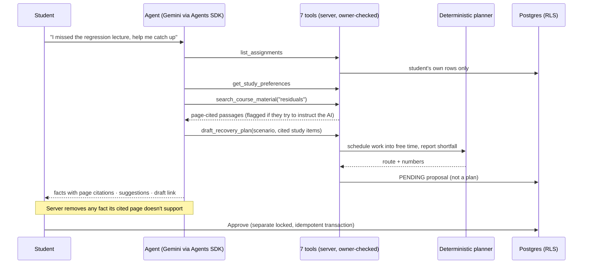

# Agentic architecture walkthrough (2 minutes to read)

**The idea:** let the model decide what to look at, but let code decide anything that has to be correct, and let the student decide anything that changes their week.

1. **Autonomous decisions (the model):** which tools to call, in what order, with what arguments (up to 8 turns), what to search for,
   which study items to propose, and when to ask a clarifying question instead of answering.
2. **Deterministic planning (code):** time-zone-safe free time, earliest deadline first, blocks of 90 minutes or less, and three routes
   with any shortfall in minutes. The model never does arithmetic on the student's schedule.
3. **Tool boundaries:** typed arguments, ownership re-checked on every call, budgets (4 searches, 1 draft, 1 memory suggestion,
   8 turns, 90 s), one run at a time, daily quota, global token budget and kill switch. No tool can save, approve or delete.
4. **RAG:** page-level chunks from the student's own PDFs; keyword search plus semantic search when a key is set; abstains when
   nothing supports an answer; flags injected instructions; claim-to-citation check before the answer is shown.
5. **Human approval:** the draft shows every block it would add, keep or cancel. Approval refuses stale, expired or infeasible
   drafts, and 10 parallel approvals produce exactly one plan.
6. **Evidence:** every tool call (name, argument summary, status, timing, outcome) is stored per run and shown in the timeline
   and the "Why trust this?" drawer, along with the model, time and tokens.
