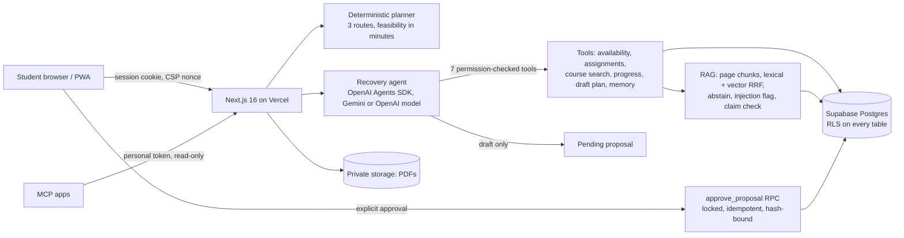

# CatchUp AI: submission package

**Live app:** https://catchupai-chi.vercel.app · **Code:** https://github.com/krish2105/CatchupAI-Agentic-AI · **Quality evidence:** https://catchupai-chi.vercel.app/quality

## 1. Description (about 100 words)
CatchUp AI helps a university student who has fallen behind get back on track. It reads the student's own lecture PDFs,
deadlines and weekly availability. A copilot answers from cited pages, a deterministic planner calculates three honest
recovery routes, and nothing is saved until the student approves it. Missed a lecture? A catch-up pack summarises it page
by page with check questions. Progress, focus sessions, quizzes and a recovery score show whether the plan is working.

**Value proposition:** most study apps plan your week, and most AI tutors answer questions. CatchUp AI connects the two
around the moment a student falls behind, and it never acts without approval or claims something its sources don't support.

## 2. Architecture

## 3. Technical walkthrough
- **Agent tools** (`src/lib/agents/tools.ts`): `get_study_preferences`, `list_assignments`, `search_course_material`,
  `get_learning_progress`, `draft_recovery_plan`, `get_student_memory`, `suggest_memory`. They take Zod-typed arguments,
  check ownership with the student's own client, and stay within budgets. Every call is recorded and shown in the timeline.
- **RAG** (`src/lib/rag/*`): page-faithful chunks, retrieval scoped to the student and course, abstention below an
  evidence threshold. Passages that try to instruct an AI are flagged, and facts are kept only if the cited passage supports them.
- **Planner** (`src/lib/planner/engine.ts`): time-zone and DST-safe windows, earliest deadline first, blocks of 90 minutes
  or less. It produces three nested routes and reports any shortfall in minutes. The model never computes these numbers.
- **Approval** (`approve_proposal`): row lock, exactly once (10 parallel requests → 1 plan), refuses stale, expired or
  infeasible drafts.

## 4. Evaluation summary (real counts)
| Suite | Result |
| --- | --- |
| Unit / integration / E2E (production build) | 103 / 99 / 65 passed |
| Agent eval (38 cases) | 30 passed · 0 failed · **8 skipped (live model not configured)** |
| RAG eval (18 questions, synthetic) | Recall@3 90.9%, abstention 4/4, cross-user 0 leaks, deleted docs 0 results; 2 documented misses |
| Claim checker (24 labelled claims) | precision 0.938, recall 1.0 |

## 5. Security and privacy
RLS on every student table, tested with two students. Nonce CSP, Origin checks, hash-only tokens, signed unsubscribe
links. AI kill switch and daily token budget. Structured logs with redaction. Data export and account deletion. Synthetic
demo data, deleted after 24 h. Details: SECURITY_AUDIT.md and AI_SECURITY_RED_TEAM_REPORT.md.

## 6. Judge Q&A
- **What's agentic?** The model chooses which tools to call and with what arguments; every call is real and logged. It can
  draft but never commit.
- **How reliable is it?** Deterministic parts are tested (planner, approval, retrieval, security). Live-model behaviour is
  **not yet measured**; the report says so.
- **How much autonomy?** Read and propose only. Saving, approving and deleting always need the student.
- **Privacy?** Each student sees only their own data (RLS), documents are private, and logs carry no content.
- **What if the AI is wrong?** Unsupported facts are removed, suggestions are labelled as advice, and the trust drawer
  shows which tools ran and what can't be known.
- **Commercial potential?** A student subscription and institution pilots are plausible but unvalidated. No customers or
  revenue are claimed.
